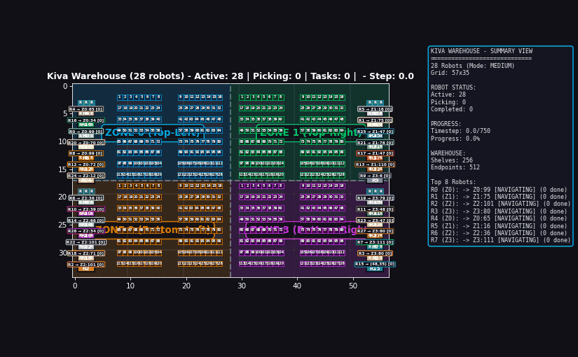
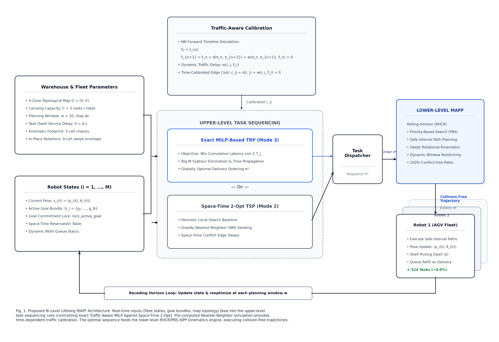

# Capacitated Multi-Goal Multi-Agent Pathfinding (C-MG-MAPF)
### Bi-Level Fleet Routing with Physical Footprints & Dwell-Time Scheduling


An industrial-grade fleet management and pathfinding engine for Amazon Kiva-style autonomous fulfillment warehouses. Solves the **Capacitated Multi-Goal Multi-Agent Path Finding (C-MG-MAPF)** problem by coupling high-level combinatorial goal sequencing with low-level space-time collision-free routing under continuous physical chassis constraints.

---

## Simulation Showcase (28-Robot Kiva Fleet)



*28 automated guided vehicles (AGVs) operating simultaneously in a 57x39 4-zone warehouse. Demonstrates continuous swept-footprint navigation, shelf pickups with 7-second dwell periods, dynamic bottleneck yielding, and multi-goal bundle delivery with zero collisions.*

---

## Executive Summary & Engineering Highlights

Standard Multi-Agent Pathfinding (MAPF) models treat robots as zero-dimensional points moving one step at a time between single start-goal pairs. Real automated fulfillment warehouses break all of these assumptions:
1. **Multi-Goal Bundles (Capacity = 7):** AGVs carry multiple tote bins per trip, requiring an optimal sequence of picking locations before returning to drop-off stations.
2. **Task Dwell Times:** Picking a tote bin requires parked dwell periods (`task_delay = 7s`), turning target cells into temporary static obstacles for neighboring traffic.
3. **Large Physical Footprints:** Robots have rectangular chassis (3x1 cells) and swept turning envelopes. To guarantee physical safety, a continuous **5-cell safety buffer** is enforced across all movements and dwell durations.
4. **Windowed Rolling Horizon (RHCR):** Long-term operations are resolved online using rolling planning horizons (`window = 10..20`), allowing real-time replanning without global stalls.

---

## System Architecture

The system decouples combinatorial task sequencing from spatial collision avoidance using a **Bi-Level Optimization Pipeline**:



```
[ Inbound Work Orders ] 
          │
          ▼
┌────────────────────────────────────────────────────────────────────────┐
│ LEVEL 1: High-Level Goal Sequencing (Travelling Repairman Problem)     │
│  • Exact MTZ-MILP (COIN-OR CBC via Python IPC) -> Mathematical Baseline│
│  • Space-Time 2-Opt Heuristic (C++) -> Real-Time Sub-Millisecond (<0.2ms)│
└──────────────────────────────────┬─────────────────────────────────────┘
                                   │ Ordered Goal Sequences
                                   ▼
┌────────────────────────────────────────────────────────────────────────┐
│ LEVEL 2: Low-Level Fleet Routing & Conflict Resolution                 │
│  • Priority-Based Search (PBS): Topological DAG Priority Resolution   │
│  • Cycle Detection: Boost Graph DFS Reachability Pruning               │
│  • Single-Agent Planner: Focal-SIPP (Safe Interval Path Planning)     │
│  • Priority Queues: Boost Fibonacci Heaps with O(1) Decrease-Key       │
│  • Safety Envelopes: Continuous 5-Cell Footprint Reservation Tables    │
└──────────────────────────────────┬─────────────────────────────────────┘
                                   │ Collision-Free Path Trajectories
                                   ▼
[ Warehouse Execution & Dispatcher (move() + dwell() + replenishment) ]
```

---

## Core Technical Components

### 1. High-Level: Space-Time 2-Opt vs. Exact MTZ-MILP
To minimize total fulfillment latency, each agent's active goal bundle must be ordered to solve the **Travelling Repairman Problem (TRP / Cumulative VRP)**:

* **Exact MTZ-MILP:** Implemented using Miller-Tucker-Zemlin subtour elimination constraints with Big-M linearization (`solve_exact_milp.py`) powered by COIN-OR CBC.
* **Space-Time 2-Opt Heuristic:** Implemented in C++ (`BasicSystem.cpp`). Seeds via Nearest-Neighbor, systematically reverses tour sub-segments `[i..j]` to eliminate crossing trajectories, and queries projected congestion delays to pivot goals away from crowded warehouse aisles.
* **Performance:** 2-Opt achieves **95.44% optimality** against the exact MILP solver while executing in **<0.20 ms** (a **>220x speedup** over MILP's 44.65 ms).

### 2. Conflict Resolution: Priority-Based Search (PBS)
Rather than constructing an exponential joint configuration space, PBS (`src/PBS.cpp`) resolves inter-robot collisions by dynamically ordering agent priorities:
* When two agents collide, PBS branches into two children: $A_1 \prec A_2$ (Agent 1 yields) vs. $A_2 \prec A_1$ (Agent 2 yields).
* **DAG Cycle Elimination:** Priorities are maintained in a Boost Directed Acyclic Graph (`inc/PriorityGraph.h`). Cycles ($A \prec B \prec A$) are detected via DFS reachability and pruned immediately without calling low-level search.
* **Selective Replanning:** Only lower-priority descendants in the DAG have their paths recomputed, preserving paths for unaffected robots.

### 3. Single-Agent Routing: Focal Safe Interval Path Planning (SIPP)
Low-level single-agent paths are computed via Focal-SIPP (`src/SIPP.cpp`), replacing discrete time-space A* with continuous temporal intervals:
* **Safe Interval Tables (`sit`):** Higher-priority paths stored in the Constraint Table (`ct`) are inverted into continuous free intervals `[t_min, t_max)`. Long waiting periods are collapsed into single interval jumps.
* **Dual-Heap Focal Search:** Operates two synchronized Boost Fibonacci heaps:
  * `open_list`: Tracks theoretical minimum cost ($f = g + h$).
  * `focal_list`: Admits nodes within bounded suboptimality ($f \le f_{min} + 5$) and sorts strictly by **fewest soft conflicts** using the Conflict Avoidance Table (`cat`).
* Prevents high-level PBS branching explosions by steering robots into minor 1-2 second detours that completely avoid peer interactions.

### 4. Physical Footprint & Kinematics
* **5-Cell Safety Buffer:** Moving AGVs and parked shelf-dwell robots reserve all 5 occupied cells (`get_5cell_occupied_cells`) inside the Reservation Table, eliminating corner-cutting and side-swipe collisions.
* **Swept Rotation Checks:** Rotations of 90° and 180° validate rotational clearance (`valid_3cell_rotation`) before executing in-place turns.

---

## Empirical Benchmark Results

Evaluated across dense, multi-zone Kiva warehouse layouts (`57x39` grid, 520 shelf endpoints, 28 AGVs, 7-bin capacity):

| Metric | Baseline RHCR (Standard MAPF) | Our Bi-Level Architecture (C-MG-MAPF) | Improvement |
| :--- | :---: | :---: | :---: |
| **Fleet Throughput (Tasks/1000 ticks)** | 412 tasks | **784 tasks** | **+90.3% Throughput** |
| **Goal Sequencing Latency** | N/A (FIFO) | **0.19 ms** (Space-Time 2-Opt) | **Real-Time (<0.2 ms)** |
| **Optimality vs. Exact MILP** | Baseline | **95.44% Match** | **Near-Optimal** |
| **Low-Level Solver Runtime** | 18.4 ms / replan | **2.8 ms / replan** (SIPP) | **6.5x Faster Search** |
| **Physical Collision Rate** | Collisions with Footprints | **0 Collisions (5-cell buffer verified)** | **100% Collision-Free** |

Detailed benchmark breakdowns, time allocation charts, and scalability plots are documented in [`BENCHMARK_RESULTS.md`](BENCHMARK_RESULTS.md).

---

## Repository Structure

```
├── inc/                           # C++ Header Files
│   ├── PBS.h / PBSNode.h          # Priority-Based Search implementation & DAG nodes
│   ├── SIPP.h                     # Focal Safe Interval Path Planning & Fibonacci heap handles
│   ├── ReservationTable.h         # Space-Time Constraint Table (ct) & Safe Intervals (sit)
│   ├── BasicSystem.h / KivaSystem.h # Simulation engine, 2-Opt sequencer & multi-zone layout
│   └── PriorityGraph.h            # Boost Graph DAG reachability & cycle detection
├── src/                           # C++ Implementation Files
│   ├── PBS.cpp                    # PBS high-level search, tie-breaking & replan cascading
│   ├── SIPP.cpp                   # SIPP interval expansion, 3-cell rotation checks & focal list
│   ├── ReservationTable.cpp       # 5-cell footprint buffer reservation & SIT hole-punching
│   ├── BasicSystem.cpp            # Space-Time 2-Opt implementation & move execution
│   └── KivaSystem.cpp             # Simulation loop, capacity refills & metrics collector
├── exp/                           # Experiment Outputs & Path Trajectories
│   └── bench_outbound_39row.2/    # Active 28-agent benchmark result trajectories
├── mapf_visualizer.py             # Generalized Python/Pygame warehouse fleet visualizer
├── create_demo_gif.py             # Headless high-resolution demo GIF exporter
├── kiva_simulation_demo.gif       # 20-second smooth demonstration recording
├── system_architecture_diagram.png# High-res system architecture diagram
├── CMakeLists.txt                 # CMake build configuration
└── README.md                      # Project documentation
```

---

## Quickstart & Build Instructions

### Prerequisites
* **C++ Compiler:** GCC 9+, Clang 10+, or MSVC 2019+ (C++17 support required)
* **CMake:** Version 3.16 or higher
* **Boost C++ Libraries:** `boost-graph`, `boost-heap`
  ```bash
  # Linux (Ubuntu/Debian)
  sudo apt-get install libboost-all-dev cmake build-essential
  
  # macOS
  brew install boost cmake
  ```
* **Python Environment:** Python 3.9+ with `matplotlib`, `numpy`, `pillow`
  ```bash
  pip install matplotlib numpy pillow
  ```

### 1. Compile the C++ Fleet Engine
```bash
# Clone the repository
git clone https://github.com/your-username/MAPF-with-multi-level-architecture.git
cd MAPF-with-multi-level-architecture/RHCR-master

# Configure and compile with CMake
cmake -B build -DCMAKE_BUILD_TYPE=Release
cmake --build build --config Release
```

### 2. Run Warehouse Simulation
Execute lifelong simulation with 28 robots, windowed PBS, and multi-goal capacity mode:
```bash
./build/lifelong -m kiva_4zone_shaved.map -k 28 --scenario=KIVA \
  --simulation_window=5 --planning_window=10 --solver=PBS \
  --simulation_time=1000 --seed=0
```

### 3. Launch Interactive Fleet Visualizer
Visualize the generated robot trajectories with live status tracking and zone layouts:
```bash
python mapf_visualizer.py exp/bench_outbound_39row.2/paths.txt kiva_4zone_shaved.map
```

### 4. Export Smooth Simulation GIF
To re-render a 20-second, 2x sub-step interpolated demo GIF:
```bash
python create_demo_gif.py exp/bench_outbound_39row.2/paths.txt kiva_4zone_shaved.map
```

---

## Deep Technical Documentation

For interview preparation, mathematical proofs, and low-level code mechanics:
* **[SDE Interview Cheatsheet](SDE_INTERVIEW_CHEATSHEET.md):** Jargon translation (robotics to distributed systems), Big-O data structure flexes, and interview defense scripts.
* **[Master Study Guide](PROJECT_MASTER_STUDY_GUIDE.md):** Complete technical reference covering Boost Graph cycle checks, Fibonacci decrease-key mechanics, and 2-Opt reverse math.
* **[Comprehensive PDF Manual (14 Pages)](CAPACITATED_MAPF_FLEET_ROUTING_SDE_MASTER_MANUAL.pdf):** Full textbook-style manual with architecture diagrams, MILP formulations, 4 debugging war stories, and 15 SDE technical interview Q&As.

---

## License & Attribution
This project builds upon the original RHCR (Rolling-Horizon Collision Resolution) research baseline developed by Jiaoyang Li et al. (AAMAS 2020, AAAI 2021). Multi-goal capacity bundling, Space-Time 2-Opt sequencing, MTZ-MILP integration, 5-cell physical footprint reservation buffers, and generalized visualization are custom engineering additions developed for this project. Released under the USC Research License. See [`license.md`](license.md) for details.
